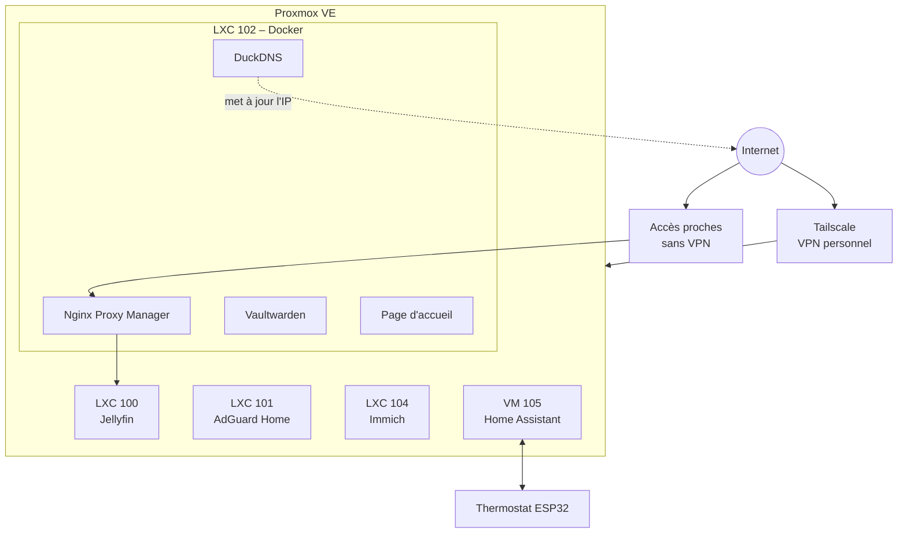

# 🖥️ Homelab

Serveur personnel auto-hébergé, monté à partir d'un mini-PC Lenovo reconditionné (~70 €) sous **Proxmox VE**.
Objectif : héberger mes propres services du quotidien (médias, photos, mots de passe, domotique) et apprendre l'administration système et réseau en conditions réelles.

---

## ⚙️ Matériel

| Composant | Détail |
|---|---|
| Machine | Mini-PC Lenovo reconditionné |
| Processeur | Intel Celeron G3900T (2 cœurs, 2,6 GHz, 35 W) |
| Mémoire | 8 Go |
| Stockage système | 68 Go (LVM) |
| Hyperviseur | Proxmox VE 9 |

Une machine modeste et peu énergivore : tout l'intérêt est d'optimiser les ressources (conteneurs LXC légers plutôt que des VM quand c'est possible).

---

## 🗺️ Architecture



---

## 🧩 Services

| ID | Type | Service | Rôle |
|---|---|---|---|
| 100 | LXC | **Jellyfin** | Serveur de streaming média (personnalisé sous le nom « Dupflix ») |
| 101 | LXC | **AdGuard Home** | DNS filtrant : blocage des publicités et traqueurs pour tout le réseau |
| 102 | LXC | **Docker** | Hôte des conteneurs ci-dessous |
| | ↳ | Nginx Proxy Manager | Reverse proxy + certificats HTTPS (Let's Encrypt) |
| | ↳ | DuckDNS | Nom de domaine dynamique (IP publique non fixe) |
| | ↳ | Vaultwarden | Gestionnaire de mots de passe compatible Bitwarden |
| | ↳ | Page d'accueil (nginx) | Point d'entrée regroupant les liens des services |
| | ↳ | Portainer Agent | Gestion des conteneurs via interface web |
| 104 | LXC | **Immich** | Sauvegarde et galerie photos (alternative à Google Photos) |
| 105 | VM | **Home Assistant** | Domotique, intégration du [thermostat ESP32](https://github.com/titouandup) |

---

## 🔐 Accès distant

Deux modes d'accès, selon le public :

- **Moi** → [Tailscale](https://tailscale.com) : VPN maillé, accès à toute l'interface d'administration sans ouvrir de port d'administration sur Internet.
- **Mes proches** → nom de domaine DuckDNS + **Nginx Proxy Manager** en HTTPS : accès à Jellyfin depuis un navigateur, sans rien installer.

Le serveur a été **migré d'un réseau à un autre** (déménagement) sans interruption durable du service pour les utilisateurs.

---

## 📚 Ce que ce projet m'a appris

- **Virtualisation** : différence VM / conteneur LXC, allocation des ressources sur une machine limitée
- **Linux** : administration en ligne de commande, gestion des services, stockage LVM
- **Réseau** : DNS, redirection de ports, NAT, IP dynamique, VPN, reverse proxy
- **Docker** : déploiement et mise à jour de services avec Docker Compose
- **Sécurité** : HTTPS, exposition minimale des services, gestion des secrets
- **Autonomie** : lecture de documentation et résolution de problèmes en conditions réelles

---

## 🚀 Évolutions prévues

- [ ] Ajout d'un NAS pour le stockage et les sauvegardes
- [ ] Sauvegardes automatiques des conteneurs (Proxmox Backup)
- [ ] Dashboard web perso (PHP + JS) : état des services et température du thermostat
- [ ] Supervision (alertes en cas de service arrêté)

---

## 📁 Contenu du dépôt

```
configs/    fichiers docker-compose (secrets retirés)
docs/img/   captures d'écran
```
